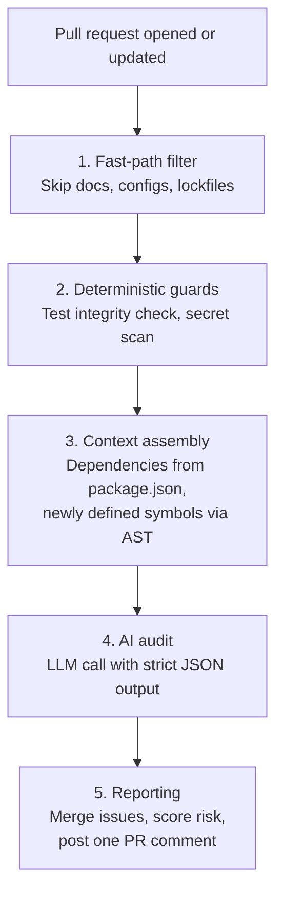

<div align="center">

# CEDA

**AI Code Debt Auditor for GitHub Pull Requests**

[](#quick-start)
[](https://github.com/your-username/ceda-auditor/releases)
[](https://github.com/your-username/ceda-auditor/actions)
[](LICENSE)
[](https://github.com/your-username/ceda-auditor/stargazers)

Catch hallucinated APIs, tampered tests, and leaked secrets **before** AI-generated code is merged.

[Quick Start](#quick-start) · [Configuration](#configuration) · [How It Works](#how-it-works) · [Roadmap](#roadmap) · [Contributing](#contributing)

</div>

---

## The Problem

AI coding assistants (Cursor, Copilot, Claude, ChatGPT) have dramatically increased development speed. They have also introduced a new kind of risk: **AI code debt**, which is code that looks correct, passes a quick skim, and is still wrong.

| Issue                   | What happens                                           | Example                                                 |
| ----------------------- | ------------------------------------------------------ | ------------------------------------------------------- |
| **Hallucinations**      | Code calls APIs, methods, or options that do not exist | `fetchUserData()` is called, but the AI invented it     |
| **Test tampering**      | Tests are edited so that broken code passes            | An assertion is rewritten to match buggy output         |
| **Silent logic errors** | Code is clean but has critical flaws                   | Unhandled `null`, missing error handling, security gaps |
| **Leaked secrets**      | Credentials get pasted into source                     | A hardcoded API key or token in a config helper         |

Compilers and linters catch many of these. CEDA targets what they miss: plausible-looking code that does not match your actual project, and changes whose _intent_ looks suspicious.

---

## What CEDA Does

CEDA is a GitHub Action that acts as an automated reviewer for AI-generated code debt. It runs in your CI pipeline on every pull request and posts a single, scannable report.

- **Test integrity check**: Flags PRs where source files and their tests are modified together, a common signal that tests were bent to fit the code.
- **Secret scanning**: Regex-based detection of hardcoded API keys, tokens, and credentials.
- **AI-powered audit**: Uses an Anthropic (Claude) or OpenAI model to identify hallucinated APIs and logic bugs in the changed code.
- **Context-aware analysis**: Extracts your project's dependencies and newly defined symbols so the model does not flag code that genuinely exists.
- **Single, clear report**: One Markdown comment per PR with a risk score, issue locations, and suggested fixes.
- **Fail-open design**: If the LLM call times out or errors, your PR is not blocked.

---

## Quick Start

**1. Add the workflow** at `.github/workflows/ceda.yml`:

```yaml
name: CEDA Audit

on:
  pull_request:
    types: [opened, synchronize, reopened]

jobs:
  audit:
    runs-on: ubuntu-latest
    permissions:
      contents: read
      pull-requests: write
    steps:
      - uses: actions/checkout@v4

      - name: Run CEDA
        uses: your-username/ceda-auditor@v0.1.0
        with:
          github-token: ${{ secrets.GITHUB_TOKEN }}
          llm-api-key: ${{ secrets.ANTHROPIC_API_KEY }}
```

**2. Add your LLM API key** as a repository secret:

1. Go to **Settings → Secrets and variables → Actions**
2. Click **New repository secret**
3. Add `ANTHROPIC_API_KEY` (or `OPENAI_API_KEY` if you use OpenAI)

**3. Open a pull request.** CEDA audits it automatically.

---

## Example Output

When CEDA finds issues, it posts a comment like this:

<!-- Add a real screenshot at docs/demo-screenshot.png, then uncomment:
<p align="center">
  
</p>
-->

> ## CEDA Audit Report
>
> **Overall Risk:** WARNING
> **Risk Score:** 65/100
> **Summary:** Detected a potential hallucinated API call and an unhandled edge case.
>
> ### HALLUCINATION (1)
>
> #### Potential Hallucinated API Call
>
> - **Location:** `src/utils/api.ts:42`
> - **Severity:** HIGH
> - **Description:** `fetchUserData()` is called but does not exist in the codebase.
> - **Fix:** Verify the correct API endpoint or implement the missing function.
>
> ### LOGIC_BUG (1)
>
> #### Unhandled Null Case
>
> - **Location:** `src/components/UserProfile.tsx:15`
> - **Severity:** MEDIUM
> - **Description:** `user.profile` may be `null` but is accessed without a check.
> - **Fix:** Add a guard, for example `if (user.profile) { ... }`.

---

## Configuration

### Inputs

| Input            | Description                                           | Required | Default               |
| ---------------- | ----------------------------------------------------- | -------- | --------------------- |
| `github-token`   | GitHub token used to read the PR and post the comment | No       | `${{ github.token }}` |
| `llm-api-key`    | API key for your LLM provider                         | **Yes**  | –                     |
| `llm-provider`   | LLM provider: `anthropic` or `openai`                 | No       | `anthropic`           |
| `risk-threshold` | Minimum risk score (0–100) required to post a comment | No       | `30`                  |
| `verbose`        | Enable verbose logging                                | No       | `false`               |

### Advanced example

```yaml
- name: Run CEDA
  uses: your-username/ceda-auditor@v0.1.0
  with:
    github-token: ${{ secrets.GITHUB_TOKEN }}
    llm-api-key: ${{ secrets.OPENAI_API_KEY }}
    llm-provider: openai
    risk-threshold: 50 # only comment on higher-risk PRs
    verbose: true # print debug logs
```

### Ignoring lines

To exclude a line from the audit, place a `ceda-ignore` comment directly above it:

```typescript
// ceda-ignore
const legacyApi = oldLibrary.deprecatedMethod();
```

---

## How It Works



1. **Fast-path filter**: Non-code files are skipped so trivial PRs finish quickly and cost nothing.
2. **Deterministic guards**: Rule-based checks run first. They need no LLM and give consistent results.
3. **Context assembly**: Project dependencies and newly defined symbols are collected to reduce false positives.
4. **AI audit**: The model reviews the changes and returns structured findings.
5. **Reporting**: All findings are merged, a risk score is calculated, and a single comment is posted.

---

## Privacy and Security

- **Code leaves your repository.** To run the AI audit, CEDA sends parts of the PR diff, plus extracted context such as dependency names, to the LLM provider you configure. Review that provider's data-handling terms before using CEDA on private or sensitive code.
- **Keep your key in secrets.** Always pass `llm-api-key` through GitHub encrypted secrets. Never commit it.
- **Least privilege.** The workflow only needs `contents: read` and `pull-requests: write`.

---

## Limitations

- **AI findings are probabilistic.** LLMs can produce false positives and miss real issues. Treat CEDA as a reviewer aid, not a replacement for human code review.
- **Test integrity is a heuristic.** Legitimate PRs often change source and tests together. A flag is a prompt to look closer, not proof of tampering.
- **Pull requests from forks.** GitHub does not expose repository secrets to `pull_request` workflows triggered from forks, so the LLM key is unavailable there. Avoid switching to `pull_request_target` as a workaround, because it runs with elevated permissions against untrusted code.
- **Language support.** Context extraction currently targets JavaScript/TypeScript projects (`package.json`). Other languages are on the roadmap.

---

## How CEDA Fits With Your Existing Tools

CEDA is designed to complement your current toolchain, not replace it.

| Tool                      | Strong at                                     | CEDA adds                                                          |
| ------------------------- | --------------------------------------------- | ------------------------------------------------------------------ |
| Linters and type checkers | Syntax, style, undefined symbols, type errors | Review of intent and logic; flags code that is plausible but wrong |
| Secret scanners           | Deep, specialized credential detection        | A lightweight built-in check in the same report                    |
| Human review              | Judgment, architecture, business context      | A fast first pass that highlights where to look                    |

---

## Roadmap

### Phase 1 (current)

- [x] Test integrity check
- [x] Secret scanning
- [x] AI-powered hallucination and logic-bug detection
- [x] Single PR comment reporting

### Phase 2 (planned)

- [ ] Custom rule configuration (`ceda.config.json`)
- [ ] Local CLI for pre-commit hooks
- [ ] Multi-language support (Python, Go, Rust)
- [ ] Docker sandbox for behavioral test verification
- [ ] Web dashboard for team analytics

---

## Contributing

Contributions are welcome. Please read the [Contributing Guide](CONTRIBUTING.md) first.

1. Fork the repository
2. Create a feature branch: `git checkout -b feature/my-feature`
3. Commit your changes: `git commit -m "feat: add my feature"`
4. Push the branch: `git push origin feature/my-feature`
5. Open a pull request

---

## Support

- **Bugs and feature requests:** [Open an issue](https://github.com/your-username/ceda-auditor/issues)
- **Questions and ideas:** [Start a discussion](https://github.com/your-username/ceda-auditor/discussions)

---

## License

Released under the [MIT License](LICENSE).
